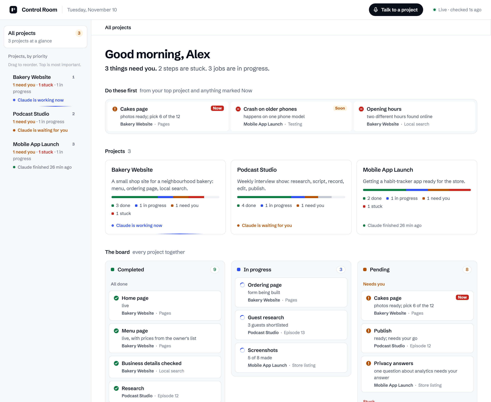
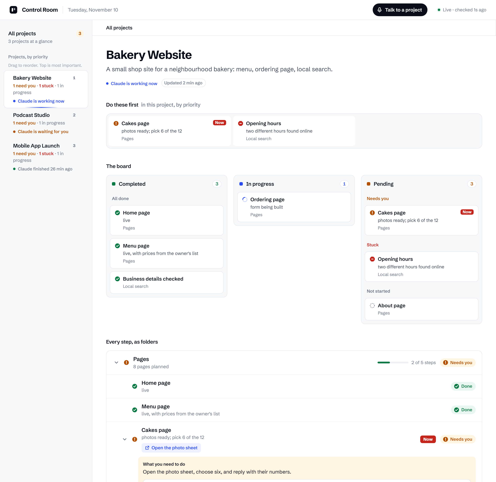
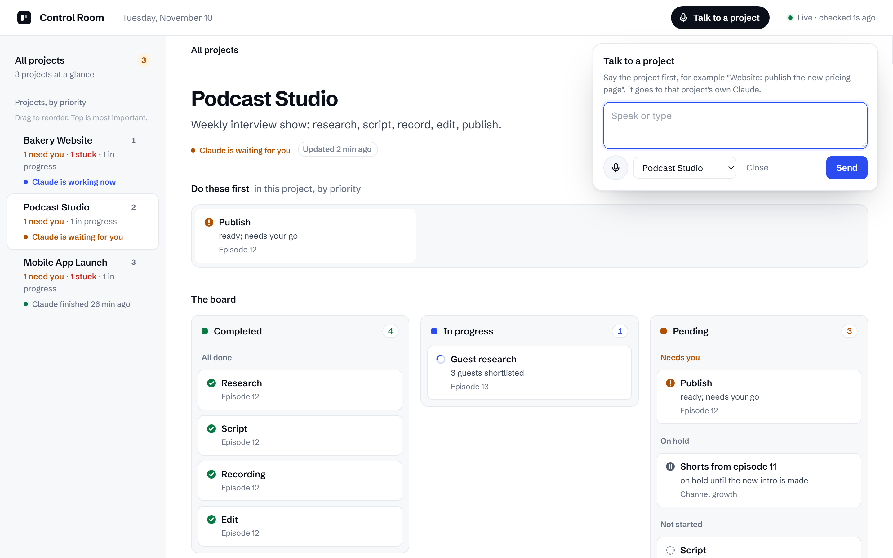

# Control Room

### Mission control for every Claude Code project you run.

You have five Claude Code chats going. One is writing pages, one is rendering videos, one finished an hour ago
and is waiting for a yes you never saw, and one quietly got stuck on Tuesday. You only find out by opening each
chat and reading.

**Control Room puts all of it on one calm, white page on your own computer.** Every project, every workstream,
every task, live: what is done, what is moving right now, what is waiting for you, and what is stuck and why.
Open a project like a folder, then a step inside it, then the reason it is blocked. Answer it right there, by
voice or by typing, and your answer goes straight to that project's own Claude.

No cloud. No API key. No accounts. No build step. One Python file, one HTML file, and the Claude Code you
already have.



---

## What you get

**One sentence that answers the morning question.**
*"3 things need you. 2 steps are stuck. 3 jobs are in progress."* Then **Do these first**: the three things that
matter most right now, from your top project and anything you marked *Now*. Finish one and the next slides in.

**A live board for everything.** Three columns across every project: **Completed** (with when, newest first),
**In progress**, and **Pending** (needs you, stuck, on hold, not started).

**Projects you open like folders.** Project › workstream › task. A stuck task tells you why and what happens
next; a waiting task tells you exactly what to do. A trail at the top (All projects › Pending › Bakery Website ›
Pages › Cakes page) always gets you back.



**See it working.** A moving line under a project means its Claude is working right now. A pulsing amber dot
means it is waiting for you. "Finished 4 min ago" means it is done. This comes from Claude Code's own hooks:
free, instant, no polling.

**Talk to any project.** Press the mic and say *"Podcast Studio: go for Thursday, but make it 10 am."* The
message goes to that project's Claude. If its chat is open, it arrives at the next step; if not, Control Room
starts that project's Claude in the background on your own plan. The reply shows up on the page.



**Your priorities, not the robot's.** Drag projects into order: top is most important. Mark any task *Now*,
*Soon* or *Later*. Hide the projects you are not working on.

**Open the work itself.** Any finished output (a video, a picture, a page, a report) gets an **Open** button. It
opens straight from the project's folder; videos play in the browser.

**Search everything.** Press / and type: every task, note, file and message across all projects, or just the one you are in. Enter jumps straight to it.

**Timeline.** Every task shows when it was added and when it last changed ("Added Nov 11, 3:40 pm (18 h ago) · Last change 2 h ago"), so you can tell what moved after your last instruction. Completed shows when each thing finished.

---

## How it works

```
 Project A chat ──writes──▶ A/docs/status.json ─┐
 Project B chat ──writes──▶ B/docs/status.json ─┼──▶ Control Room (localhost:9999) ──▶ you
 Project C chat ──writes──▶ C/docs/status.json ─┘          │
        ▲                                                   │ voice / text
        └────────────── your message, to that project ◀────┘
 Claude Code hooks ──▶ ~/.control-room/  (working · waiting · finished)
```

1. **Each project describes itself.** Its own Claude keeps one small file, `docs/status.json`: a tree of what is
   done, running, waiting and stuck. ([schema](docs/schema.md))
2. **Hooks report what Claude is doing**, in a tiny state file. No model calls.
3. **The Control Room reads those files** and draws the page. It finds every folder you have ever opened Claude
   Code in by itself. A project without a status file yet shows as "not set up yet" and fills in the first time
   its chat runs.

Projects never see each other. Each chat writes only its own file; the page is the only place they sit side by
side. A client project and a personal project can share the screen without sharing anything else.

## Install

You need Python 3.9 or newer and Claude Code.

```bash
git clone https://github.com/Samrezkhan/claude-code-control-room.git
cd claude-code-control-room/control-room
python install.py --autostart --name "Your name"
```

Then open **http://localhost:9999** (Chrome and Edge also take **http://control.localhost:9999**).

- `install.py` adds five hooks to `~/.claude/settings.json` (a backup is written first). `--autostart` starts
  the Control Room when you log in (Windows, macOS, Linux). `python install.py --uninstall` removes everything.
- **Teach each project to keep its status:** copy `skill/control-room` into `~/.claude/skills/` (all projects) or
  a project's `.claude/skills/`. New sessions are also reminded by the hook. For a chat that was already
  running, just tell it: *"Set up the Control Room status for this project."*
- **Voice** uses the browser's own speech recognition (Chrome, Edge). Allow the microphone the first time.
- **Talking to a closed project** runs `claude -p` in that project's folder. Sign the Claude Code command line
  in once (`claude`, then `/login`) so it can.

Try it with the demo projects first:

```bash
python control-room/server.py --root examples/demo --name Alex
```

## Safety

- The server listens on your own computer only (127.0.0.1). Nothing is uploaded anywhere.
- Only the page the server itself serves can send messages or change settings: every request carries a key made
  fresh at each start, so other websites open in your browser cannot use it.
- The **Open** button serves only files inside that project's folder, and always refuses `keys/`, `.env`, `.git`,
  `.ssh` and similar.
- The hooks store only a state word, a folder path and a time.

## Files

| | |
|---|---|
| `control-room/server.py` | the local server: finds projects, reads status files, history, messages |
| `control-room/index.html` | the whole page, no framework |
| `control-room/live-hook.py` | the Claude Code hook: working / waiting / finished, and hands messages to an open chat |
| `control-room/reply.py` | lets a chat answer a message in the Control Room |
| `control-room/install.py` | hooks and autostart, in and out |
| `skill/control-room/SKILL.md` | the Claude Code skill that keeps a project's status current |
| `docs/schema.md` | the status file, field by field |
| `docs/how-it-was-built.md` | the decisions behind it |
| `examples/demo/` | three made-up projects to try it with |

## License

MIT. Use it, change it, ship it.
